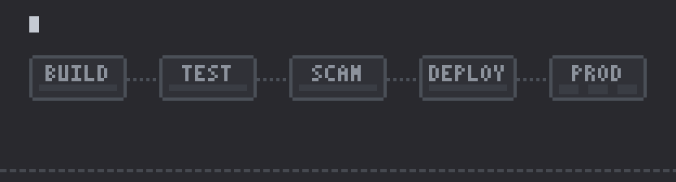
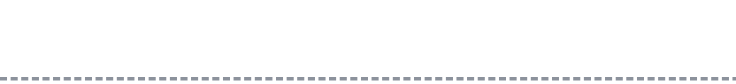

  

# Hamzah Chairil Salim

*I like my deploys boring and my dashboards green.*

I'm a DevOps engineer in South Tangerang, Indonesia. I deploy and run workloads on AWS EKS, build GitOps delivery with Helm and Argo CD, and set up monitoring with Prometheus, Loki and Grafana. Before DevOps I built Python backends for chatbots and AI services.

I'm looking for DevOps, SRE or platform engineering roles in Greater Jakarta or remote, and I can start now.

## Recent work

- LG Sinar Mas (2026): led monitoring for an HR system on production EKS that had none, and cut service onboarding from 11 steps to 5.
- SQE x Apple Developer Institute (2026): co-led a team of 3 that moved AWS into 15 Terraform modules behind Atlantis, and designed our Argo CD delivery platform.
- Prosa.ai, Pusat AI ITB and PUSAKA Unair (2021 to 2026): built Python backends for chatbots and AI services.

## Side projects

- [nudge-lamp](https://github.com/yoshimoriryu/nudge-lamp) is a macOS menu bar light bulb that shows when a Claude Code session is working, waiting for me, or idle. The bulb in the banner comes from it.
- [4wide-trainer](https://github.com/yoshimoriryu/4wide-trainer) is a 4-wide Tetris combo trainer. Its coach checks every move against an exact search of the piece queue.
- [lastword](https://github.com/yoshimoriryu/lastword) is a typing battle royale for 2 to 6 players on one LAN, with bots.
- [overthewire-journey](https://github.com/yoshimoriryu/overthewire-journey) holds my notes from the OverTheWire Bandit and Natas wargames.

## Learning

I'm preparing for the Certified Kubernetes Administrator (CKA) exam, planned for December 2026. I finished Kubernetes The Hard Way on self-hosted VMs.

## Tools

AWS (EKS, EC2, VPC, IAM, RDS, S3, Secrets Manager), Kubernetes, Helm, Argo CD, Argo Rollouts, Terraform, Atlantis, Packer, Ansible, Docker, GitLab CI, GitHub Actions, Jenkins, Prometheus, Grafana, Loki, Linux, Python, Bash, FastAPI, PostgreSQL and Redis.

## Education

B.Eng. in Informatics, Bandung Institute of Technology (ITB), 2024.

## Contact

- Email: hamzah.chairil98@gmail.com
- LinkedIn: [linkedin.com/in/hamzah-chairil-salim](https://www.linkedin.com/in/hamzah-chairil-salim/)
- LeetCode: [leetcode.com/u/yoshimoriryu](https://leetcode.com/u/yoshimoriryu/)

  

Both animations are drawn by [scripts/banner.py](scripts/banner.py) with the sprite from nudge-lamp.
